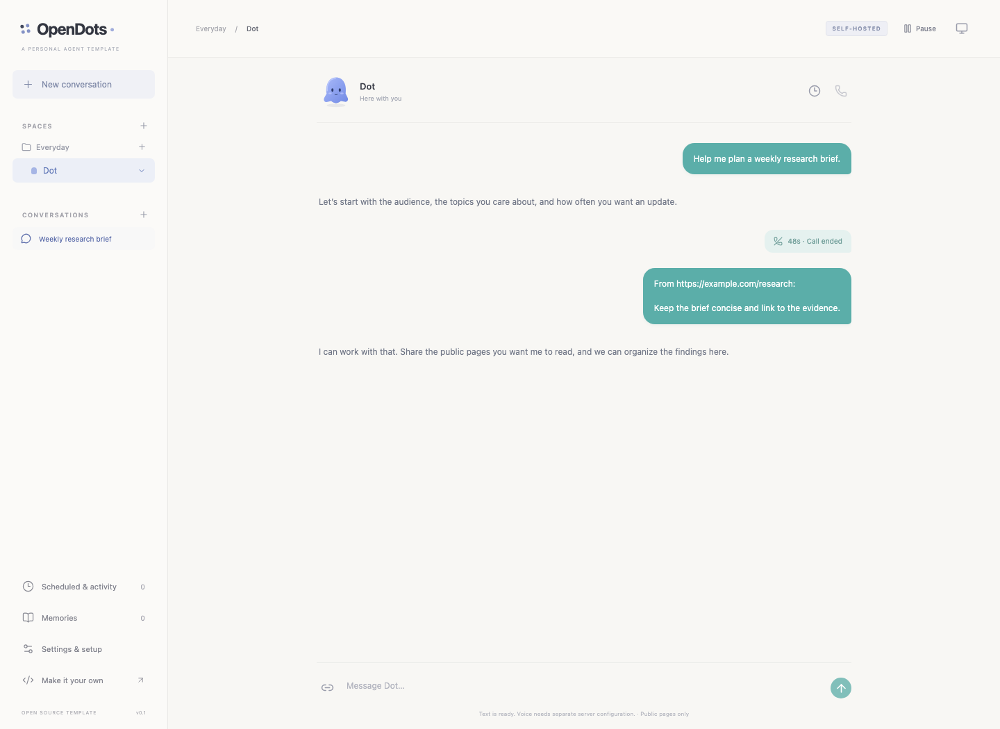
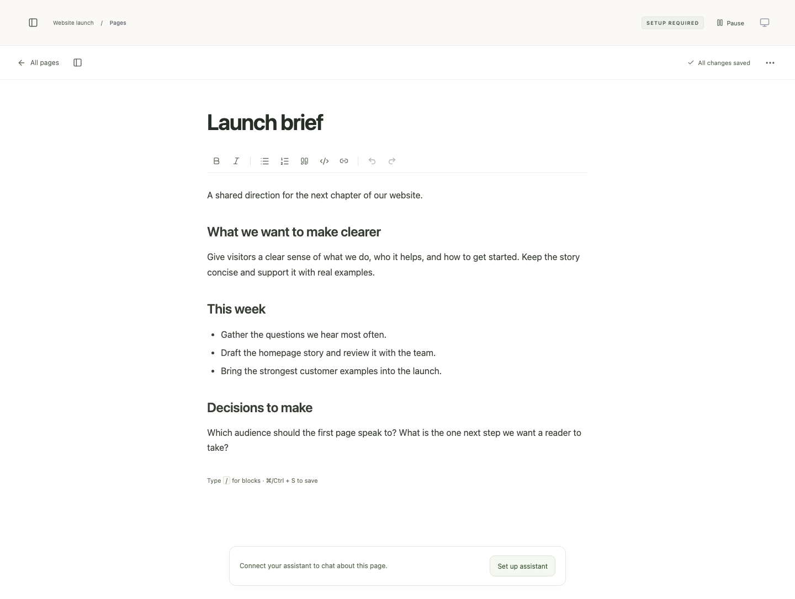
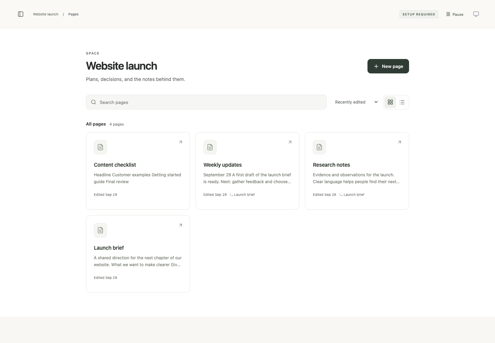

# AETHER

<div align="center">
  <h3>Next-Generation Self-Hosted Personal AI Agent Workspace and Native Desktop Ecosystem</h3>
  <p>Created by <strong>Soumya Chakraborty</strong> (<a href="https://github.com/soumyachk101">@soumyachk101</a>)</p>

  <p>
    <a href="LICENSE"></a>
    <a href="https://nodejs.org/"></a>
    <a href="https://www.rust-lang.org/"></a>
    <a href="https://developer.apple.com/swift/"></a>
    <a href="CONTRIBUTING.md"></a>
  </p>
</div>

---

## Table of Contents

- [Overview](#overview)
- [Visual Overview](#visual-overview)
- [System Architecture](#system-architecture)
- [Repository Structure](#repository-structure)
- [Core Features](#core-features)
  - [Autonomous Specialist Dots](#autonomous-specialist-dots)
  - [Collaborative Document Studio](#collaborative-document-studio)
  - [Sandboxed Docker Computers](#sandboxed-docker-computers)
  - [Conversational Voice Mode](#conversational-voice-mode)
  - [Tooling and Integrations](#tooling-and-integrations)
  - [Embedded Local Storage](#embedded-local-storage)
- [Technology Stack](#technology-stack)
- [Prerequisites](#prerequisites)
- [Quick Start Guide](#quick-start-guide)
  - [1. Web Workspace (AETHER-web)](#1-web-workspace-aether-web)
  - [2. macOS Native Shell (AETHER-swift)](#2-macos-native-shell-aether-swift)
  - [3. Cross-Platform Desktop Shell (AETHER-rust)](#3-cross-platform-desktop-shell-aether-rust)
  - [4. Sandboxed Computers Setup](#4-sandboxed-computers-setup)
- [Configuration and Environment Variables](#configuration-and-environment-variables)
- [Desktop Integration and Platform Parity](#desktop-integration-and-platform-parity)
- [Security and Privacy Architecture](#security-and-privacy-architecture)
- [Testing and Quality Assurance](#testing-and-quality-assurance)
- [Documentation Directory](#documentation-directory)
- [Contributing](#contributing)
- [Author](#author)
- [License](#license)

---

## Overview

**AETHER** is an open-source, private, self-hosted AI agent workspace and native desktop suite engineered for deep focus, intelligence augmentation, and autonomous agent orchestration. 

Modern knowledge work demands flexible interaction between human thoughts, structured documents, and AI capabilities. AETHER replaces fragmented SaaS tools by unifying rich document editing, multi-agent conversational threads, isolated containerized execution environments, and real-time voice streaming into a single, cohesive local-first environment.

### Why AETHER?

- **Complete Data Ownership**: Your documents, agent conversations, memories, and workspace files reside entirely on your machine in embedded SQLite databases.
- **Native Platform Parity**: Experience the same feature-rich interface through the browser, a native macOS AppKit shell, or a cross-platform desktop shell.
- **Autonomous Specialist Agents ("Dots")**: Define focused AI personas with distinct instructions, custom tool access, and durable memory ledgers.
- **True Execution Isolation**: Give agents real browsing and bash computing capabilities via secure, sandboxed Docker containers protected by cryptographic tokens.
- **Zero Cloud Lock-in**: Fully functional with self-hosted models, API keys of your choice, and extensible via the Model Context Protocol (MCP).

---

## Visual Overview

<div align="center">
  
  <p><em>Multi-agent conversational interface with real-time thread tracking and specialist Dots</em></p>
  <br />

  
  <p><em>TipTap collaborative document editor with markdown synchronization and agent assistance</em></p>
  <br />

  
  <p><em>Structured document and space library for organizing personal intelligence</em></p>
</div>

---

## System Architecture

AETHER is organized as a unified monorepo consisting of three coordinated runtime layers:

```
+-------------------------------------------------------------------------+
|                              AETHER Ecosystem                           |
+-------------------------------------------------------------------------+
|                                                                         |
|  +--------------------+  +--------------------+                         |
|  |    AETHER-swift    |  |    AETHER-rust     |                         |
|  | (macOS Native App) |  | (Cross-Platform)   |                         |
|  | AppKit + WKWebView |  | Tao + Wry Webview  |                         |
|  +---------+----------+  +---------+----------+                         |
|            |                       |                                    |
|            +-----------+-----------+                                    |
|                        | (Local Loopback HTTP / WebSocket)              |
|                        v                                                |
|  +-------------------------------------------------------------------+  |
|  |                             AETHER-web                            |  |
|  |  +-------------------------------------------------------------+  |  |
|  |  |                    Frontend UI Layer (React 19)             |  |  |
|  |  | - TipTap Collaborative Rich Editor                          |  |  |
|  |  | - Multi-Agent Chat & Threads                                |  |  |
|  |  | - WebRTC Ambient Audio / Voice Studio                       |  |  |
|  |  | - Computer Sandbox Management UI                            |  |  |
|  |  +------------------------------+------------------------------+  |  |
|  |                                 | (Internal Fetch / EventStream)  |  |
|  |  +------------------------------v------------------------------+  |  |
|  |  |                   Backend Services (Hono / Node.js)         |  |  |
|  |  | - CopilotKit Intelligence & Agent Runtime                   |  |  |
|  |  | - Dot Agent Management Engine                               |  |  |
|  |  | - SQLite Document & Vector Store (WAL Mode)                 |  |  |
|  |  | - MCP Tool Broker & Composio Integration                    |  |  |
|  |  | - Slack Sockets & Telemetry Pipeline                        |  |  |
|  |  +------------------------------+------------------------------+  |  |
|  +---------------------------------|---------------------------------+  |
|                                    |                                    |
+------------------------------------|------------------------------------+
                                     | (Docker Engine Socket / Loopback HTTP)
                                     v
+-------------------------------------------------------------------------+
|                 Sandboxed Docker Computer Environment                   |
+-------------------------------------------------------------------------+
|  +-------------------------------------------------------------------+  |
|  |                     Computer Supervisor Daemon                     |  |
|  |  - Container Lifecycle Manager                                    |  |
|  |  - HMAC-SHA256 Token Gatekeeper                                   |  |
|  +-----------------------------------+-------------------------------+  |
|                                      |                                  |
|         +----------------------------+----------------------------+     |
|         v                                                         v     |
|  +-------------------------------+         +--------------------------+ |
|  |   Agent Sandbox Container A   |         | Agent Sandbox Container B| |
|  | - Chromium Browser Instance   |         | - Headless Environment   | |
|  | - Isolated Persistent Volumes |         | - Bash Tooling           | |
|  +-------------------------------+         +--------------------------+ |
+-------------------------------------------------------------------------+
```

For an in-depth architectural breakdown, see the [System Architecture Guide](docs/ARCHITECTURE.md).

---

## Repository Structure

```
AETHER/
├── AETHER-web/                   # Primary web workspace, backend server, and agent runtime
│   ├── src/
│   │   ├── client/               # React 19 UI (TipTap editor, chat, voice, controls)
│   │   ├── server/               # Hono backend services, agent engine, SQLite store
│   │   └── shared/               # Universal TypeScript types and message contracts
│   ├── deployment/computers/     # Docker supervisor configuration and hardening scripts
│   ├── compose.yml               # Container deployment for web workspace
│   ├── compose.computers.yml     # Sandboxed Docker computer supervisor services
│   └── tests/                    # Vitest test suites (54 suites, 344 tests)
├── AETHER-swift/                 # Native macOS desktop shell
│   ├── Sources/AETHER/           # Swift AppKit code, WKWebView bindings, server controller
│   ├── Packaging/                # macOS Info.plist, entitlements, app icon assets
│   └── scripts/                  # Automated build and bundling scripts (build-macos.sh)
├── AETHER-rust/                  # Cross-platform desktop shell (Windows, Linux, macOS)
│   ├── src/main.rs               # Rust application entry point, Wry/Tao webview wrapper
│   └── packaging/                # Linux .desktop configuration and icons
├── docs/                         # Canonical technical documentation
│   ├── ARCHITECTURE.md           # System design, data flow, and IPC specification
│   ├── SETUP.md                  # Comprehensive setup and environment instructions
│   ├── COMPUTERS.md              # Docker sandbox deployment and supervisor setup
│   └── SETUP-TELEMETRY.md        # Privacy controls and opt-out instructions
├── .github/                      # GitHub issue and PR templates, CI workflows
├── CONTRIBUTING.md               # Contribution workflow and coding standards
├── CODE_OF_CONDUCT.md            # Contributor Covenant v2.1 pledge
├── ACCESSIBILITY.md              # WCAG 2.1 Level AA conformance statement
├── SECURITY.md                   # Vulnerability disclosure and security architecture
├── SUPPORT.md                    # Getting support and filing issues
├── CHANGELOG.md                  # Semantic versioning release log
└── LICENSE                       # Canonical MIT License (Soumya Chakraborty)
```

---

## Core Features

### Autonomous Specialist Dots
- Create specialized agents ("Dots") tailored for distinct tasks such as research, code review, drafting, or data analysis.
- Define custom system prompts, tool allowances, and behavioral rules per Dot.
- Built-in persistent memory ledger allows Dots to retain context across conversations without polluting other threads.
- Thread isolation enables asynchronous workflows across multiple specialists simultaneously.

### Collaborative Document Studio
- TipTap-powered collaborative rich-text and block document editor.
- Full two-way Markdown synchronization: read, write, import, and export markdown seamlessly.
- Real-time agent collaboration: summon Dots directly into your documents to write, revise, summarize, or restructure content.
- Revision history and document rollback support.

### Sandboxed Docker Computers
- Provide agents with real computing capabilities without compromising host system security.
- Runs isolated Chromium instances and bash environments inside lightweight Docker containers.
- Cryptographically verified HMAC-SHA256 supervisor token authentication.
- Dedicated named volumes for each Dot ensure file isolation and persistent browser profiles.
- Host-supervised execution gives users real-time oversight and takeover control.

### Conversational Voice Mode
- Low-latency WebRTC two-way audio streaming directly in the browser and native desktop shells.
- Ambient speech transcription with live waveform visualization.
- Voice receipts automatically generate durable summaries and store transcripts in the document library.

### Tooling and Integrations
- **Model Context Protocol (MCP)**: Connect external MCP tools and resources dynamically to your Dots.
- **Composio**: Integrate hundreds of third-party SaaS apps and developer tools.
- **Slack Socket Integration**: Connect your AETHER workspace to Slack channels for remote interaction.
- **Parallel Web Search**: Real-time web retrieval provider for up-to-date research tasks.

### Embedded Local Storage
- Built-in SQLite database operating in WAL (Write-Ahead Logging) mode.
- High-concurrency performance with zero external database service configuration needed.
- Complete data persistence for workspaces, spaces, documents, chat histories, agent definitions, and memories.

---

## Technology Stack

| Layer | Component | Technologies |
|---|---|---|
| **Frontend** | Workspace UI | React 19, TypeScript, TipTap Editor, Lucide Icons, Vanilla CSS |
| **Backend** | Server Runtime | Node.js 22+, Hono, CopilotKit Runtime v2 |
| **macOS Native** | Desktop Shell | Swift 5.9+, AppKit, WKWebView, WebRTC Audio Integration |
| **Cross-Platform** | Desktop Shell | Rust 1.85+, Tao (Window Management), Wry (Webview Engine) |
| **Database** | Persistence | Embedded SQLite (WAL mode), JSON-based configuration |
| **Sandboxes** | Computer Environment | Docker Engine, Bun runtime, Chromium Headless, Alpine Linux |
| **Testing** | Quality Assurance | Vitest, Testing Library, TypeScript Compiler (`tsc`), Cargo Test, Swift Test |

---

## Prerequisites

Before setting up AETHER, ensure your development environment satisfies these requirements:

- **Node.js**: `v22.0.0` or higher (tested on Node.js v24+)
- **npm**: `v10.0.0` or higher
- **Rust**: `1.85+` with `cargo` (required for `AETHER-rust`)
- **Swift / Xcode**: Swift 5.9+ / Xcode 15+ (required for `AETHER-swift` on macOS)
- **Docker Engine**: Docker Desktop or Lima/Colima (required for sandboxed computer execution)

---

## Quick Start Guide

### 1. Web Workspace (AETHER-web)

The web workspace is the foundation of the AETHER ecosystem:

```bash
# Clone the repository
git clone https://github.com/soumyachk101/AETHER.git
cd AETHER/AETHER-web

# Install dependencies
npm ci

# Configure environment variables
cp .env.example .env

# Start the development server
npm run dev
```

Visit `http://localhost:3000` in your browser.

To create an optimized production build:
```bash
npm run build
npm start
```

### 2. macOS Native Shell (AETHER-swift)

The native macOS application provides WKWebView performance, system menu shortcuts, and automatic background server management:

```bash
cd AETHER/AETHER-swift

# Build the native .app bundle
./scripts/build-macos.sh

# Launch the compiled macOS application
open dist/macos/AETHER.app
```

The shell automatically launches the local Node.js backend on an available loopback port and manages its process lifecycle.

### 3. Cross-Platform Desktop Shell (AETHER-rust)

For Linux, Windows, or lightweight macOS desktop usage:

```bash
cd AETHER/AETHER-rust

# Check and build with Cargo
cargo check
cargo run --release
```

### 4. Sandboxed Computers Setup

To enable isolated web browsing and shell execution for your Dots:

```bash
cd AETHER/AETHER-web

# Set supervisor secrets in .env
# COMPUTER_SUPERVISOR_TOKEN=<secure-random-token-1>
# COMPUTER_TOKEN=<secure-random-token-2-min-24-chars>

# Start the supervisor daemon and sandbox images
docker compose -f compose.computers.yml up -d
```

---

## Configuration and Environment Variables

AETHER is configured using `.env` files. Below are key environment variables:

| Variable | Description | Default | Required |
|---|---|---|---|
| `PORT` | Local HTTP and WebSocket server port | `3000` | No |
| `CPK_INTELLIGENCE_API_KEY` | Model API key for intelligence runtime | None | Yes |
| `COMPUTER_SUPERVISOR_URL` | Loopback address of the computer supervisor | `http://127.0.0.1:4312` | If using computers |
| `COMPUTER_SUPERVISOR_TOKEN` | Secret token for supervisor daemon authentication | None | If using computers |
| `COMPUTER_TOKEN` | Master secret (min 24 chars) for per-Dot HMAC derivation | None | If using computers |
| `COMPUTER_NAMESPACE` | Identifier for persistent Docker volumes and containers | `aether` | No |
| `WEB_SEARCH_PROVIDER` | Search provider (`parallel`, `browser`, or `disabled`) | `parallel` | No |
| `SLACK_CHANNEL_NAME` | Slack channel name for socket integration | None | Optional |
| `DO_NOT_TRACK` | Disable all anonymous diagnostic telemetry (`1` or `true`) | None | No |
| `COPILOTKIT_TELEMETRY_DISABLED` | Disable runtime telemetry reporting (`true`) | None | No |

---

## Desktop Integration and Platform Parity

AETHER is built from the ground up for desktop parity across platforms:

- **macOS Shell (`AETHER-swift`)**:
  - Full AppKit menu bar with standard macOS shortcuts (⌘N for new dot, ⌘W to close, ⌘Q to quit, ⌘R to refresh).
  - Built-in `WKUIDelegate` handling WebRTC microphone prompts natively without extra browser dialogs.
  - Automatic background child process management: launches the Node.js server silently on startup and terminates child processes on application quit.
- **Cross-Platform Shell (`AETHER-rust`)**:
  - Compact binary powered by Wry and Tao.
  - Zero heavy Chromium bundling overhead compared to standard Electron apps.
  - Linux desktop environment integration with `.desktop` file specifications.

---

## Security and Privacy Architecture

AETHER enforces a zero-trust model between host environments and agent capabilities:

1. **Loopback-Only Bindings**: Local HTTP, WebSocket, and supervisor daemons bind strictly to `127.0.0.1` and `[::1]`, eliminating unintended local network exposure.
2. **Container Privilege Revocation**: Sandbox containers run with dropped Linux capabilities (`cap_drop: [ALL]`) and security options (`no-new-privileges:true`).
3. **Cryptographic Child Tokens**: Supervisor actions verify HMAC-SHA256 tokens (`x-aether-bot-id`), ensuring agents cannot cross boundary contexts or manipulate other Dots' containers.
4. **Host Oversight**: Terminal commands and browser navigations executed by sandbox computers are logged and subject to user takeover and suspension.
5. **Privacy by Design**: Telemetry is opt-out configurable via standard `DO_NOT_TRACK=1` or `COPILOTKIT_TELEMETRY_DISABLED=true`.

---

## Testing and Quality Assurance

AETHER maintains strict test coverage across all layers:

```bash
# Run web workspace unit and integration tests (54 suites, 344 tests)
cd AETHER-web
npm test

# Run TypeScript strict type verification
npm run typecheck

# Check code formatting with Prettier
npm run format:check

# Run Rust unit tests and clippy
cd ../AETHER-rust
cargo test
cargo clippy

# Run Swift tests (macOS)
cd ../AETHER-swift
swift test
```

---

## Documentation Directory

Comprehensive technical guides are maintained centrally in the [`docs/`](docs/) directory:

- **[Installation and Setup Guide](docs/SETUP.md)**: Detailed environment and dependency installation walkthrough.
- **[System Architecture Guide](docs/ARCHITECTURE.md)**: In-depth technical architecture, data flows, and IPC protocol.
- **[Agent Computers and Sandboxing](docs/COMPUTERS.md)**: Setting up Docker containers and supervisor contracts.
- **[Telemetry and Privacy Settings](docs/SETUP-TELEMETRY.md)**: Managing telemetry flags and privacy configurations.
- **[Contributing Guidelines](CONTRIBUTING.md)**: Pull request workflow, branch conventions, and commit standards.
- **[Code of Conduct](CODE_OF_CONDUCT.md)**: Contributor Covenant v2.1 community pledge.
- **[Accessibility Statement](ACCESSIBILITY.md)**: WCAG 2.1 Level AA digital accessibility standards.
- **[Security Policy](SECURITY.md)**: Vulnerability disclosure policy and security principles.
- **[Support and Help](SUPPORT.md)**: How to file issues, get help, and contact maintainers.
- **[Changelog](CHANGELOG.md)**: Historical record of changes across releases.

---

## Contributing

We welcome contributions from the community. Before submitting changes, please review our [Contributing Guidelines](CONTRIBUTING.md) and [Code of Conduct](CODE_OF_CONDUCT.md).

1. Fork the repository on GitHub.
2. Create a topic branch: `git checkout -b feat/your-feature-name`
3. Commit your changes following Conventional Commits.
4. Verify tests pass: `npm test && npm run typecheck`
5. Open a Pull Request targeting the `main` branch.

---

## Author

- **Soumya Chakraborty**
- GitHub: [@soumyachk101](https://github.com/soumyachk101)
- Repository: [https://github.com/soumyachk101/AETHER](https://github.com/soumyachk101/AETHER)
- Contact: `soumya.chk101@gmail.com`

---

## License

This project is licensed under the [MIT License](LICENSE). Copyright (c) Soumya Chakraborty.
